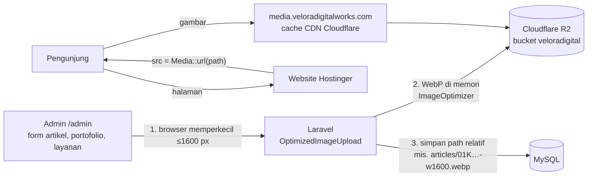

# Gambar Website di Cloudflare R2 (DEC-19)

Terakhir diperbarui: 2026-10-14 (sore). Branch: `fix/performance` (belum di-commit).
Langkah deploy ke server ada di [`DEPLOY-CHECKLIST.md` bagian 6](DEPLOY-CHECKLIST.md#6-gambar-di-cloudflare-r2-media_diskr2).
Dokumen ini mencatat **alasan, arsitektur, konfigurasi Cloudflare, log perpindahan DNS, status, dan risiko**.

## 1. Ringkasan status

| Bagian | Status |
|---|---|
| Kode (upload admin → R2, halaman publik dari R2, perintah `media:*`) | ✅ Selesai, 670 tes lulus |
| Bucket R2 `veloradigital` + API token + CORS | ✅ Dibuat |
| 39 gambar lama dikirim ke R2 | ✅ Selesai, identik byte-per-byte |
| Website **lokal** memakai R2 (`MEDIA_DISK=r2`) | ✅ Berjalan dari `https://media.veloradigitalworks.com` |
| Upload lewat form admin ke bucket asli | ✅ Terverifikasi (PNG 1,18 MB → WebP 40 KB) |
| DNS `veloradigitalworks.com` pindah ke Cloudflare | ✅ Nameserver berpindah, 13/13 record sama |
| Domain kustom `media.veloradigitalworks.com` di bucket (TLS minimum 1.2) | ✅ Active, cache CDN HIT, SSL valid s.d. 12 Jan 2027 |
| `R2_PUBLIC_URL` → domain kustom + uji anti-blokir | ✅ Lewat DNS ICONNET (tanpa WARP): `r2.dev` diblokir, `media.…` lancar |
| Produksi Hostinger (deploy kode, `.env` server, `media:sync` di server) | ⏳ Belum |
| Optimasi gambar lama di R2 (`images:optimize`), database **lokal** | ✅ 37 gambar 37,7 MB → 4,7 MB (manifest `20261014-031314.json`) |
| Commit + PR `fix/performance` → `development` | ⏳ Menunggu keputusan |

## 2. Latar belakang dan keputusan

**Masalah sebelumnya**
1. Di Hostinger, file yang dilayani web ada di `public_html/storage`, yang merupakan salinan manual dari `storage/app/public`.
   Akibatnya upload baru lewat admin tidak otomatis tampil di website.
2. Gambar upload berukuran besar (sampai 6,5 MB per gambar) membuat halaman berat. Lihat audit performa 2026-10-13.

**Keputusan (DEC-19, 2026-10-14, oleh pemilik produk):** gambar konten website disimpan di Cloudflare R2.

| Opsi yang dipertimbangkan | Alasan tidak/dipilih |
|---|---|
| Tetap disk hosting + symlink/salin otomatis | Bergantung pada fitur shared hosting dan tetap membebani bandwidth hosting |
| **Cloudflare R2** ✅ | Upload langsung ke satu tempat, egress gratis, cache CDN (dengan domain kustom), murah untuk skala UMKM |
| AWS S3 / CDN gambar berbayar | Ada biaya egress atau langganan bulanan; berlebihan untuk kebutuhan sekarang |

**Temuan penting: `*.r2.dev` tidak bisa diakses di Indonesia.** Menurut laporan publik (Juni 2026), Kemkomdigi memblokir
domain `r2.dev` milik Cloudflare karena disalahgunakan, sehingga semua ISP menerapkannya. Terbukti pada uji 2026-10-14:
DNS XL mengarahkan `pub-….r2.dev` ke `blockpage.xlaxiata.id` (bahkan untuk query ke 1.1.1.1, karena port 53 dibelokkan),
dan DNS ICONNET mengarahkannya ke `202.62.8.232` (milik ICONNET) lalu timeout. Di jaringan yang sama, domain kustom
berjalan normal, karena blokir menyasar domain `r2.dev`, bukan bucket atau jaringan Cloudflare. Karena itu URL publik
**wajib domain kustom**, dan domain kustom R2 mensyaratkan DNS domain dikelola Cloudflare (lihat bagian 5).

## 3. Arsitektur

| Prinsip | Penjelasan |
|---|---|
| Database hanya menyimpan **path relatif** | Pindah disk (lokal ↔ R2) tidak mengubah data, cukup menyalin file dan mengganti `MEDIA_DISK` |
| Satu sakelar `MEDIA_DISK` | `public` = `storage/app/public` (lokal), `r2` = Cloudflare R2. Dibaca oleh upload admin, tabel admin, dan semua halaman publik |
| ACL dipaksa `private` | R2 **menolak** `x-amz-acl: public-read` (NotImplemented), padahal Laravel/Filament mengirimnya untuk visibility `public`. Akses publik diatur di level bucket |
| `Cache-Control: public, max-age=31536000, immutable` | Nama file unik (ULID / `-w<lebar>.webp`) dan tidak pernah ditimpa |
| Gagal-aman | Bila konversi WebP gagal, file asli yang disimpan; upload tidak pernah gagal karena optimasi |

## 4. Komponen kode

| File | Fungsi |
|---|---|
| `config/filesystems.php` | `media_disk` (`MEDIA_DISK`) dan disk `r2` (S3, region `auto`, path-style, `ACL=private`, Cache-Control, `throw=true`) |
| `app/Support/Media.php` | `Media::disk()`, `Media::url($path, $fallback)` (disk `public` tetap memakai `asset('storage/…')`), `Media::configProblem()` |
| `app/Filament/Forms/OptimizedImageUpload.php` | Upload admin: resize di browser, konversi WebP di memori, lalu tulis hanya hasilnya ke disk media |
| `app/Services/Media/ImageOptimizer.php` | `convert()` (di memori) dan `optimize()` (baca/tulis lewat API disk, sehingga berlaku untuk R2) |
| Form, tabel, dan infolist Filament (Artikel, Portofolio, Layanan) | Disk mengikuti `Media::disk()`. Gambar di isi artikel (RichEditor) juga ke disk media (`articles/content`) |
| `PortfolioController` + 5 view publik | `Media::url()` menggantikan `asset('storage/…')` |
| `app/Console/Commands/SyncMedia.php` | `media:sync` |
| `app/Console/Commands/CheckMedia.php` | `media:check` |
| `app/Console/Commands/OptimizeImages.php` | `images:optimize` bekerja di disk media aktif; mirror `public_html/storage` hanya untuk disk `public` |
| `phpunit.xml` | Memaksa `MEDIA_DISK=public` dan mengosongkan kredensial R2, sehingga **tes tidak pernah menulis ke bucket asli** |
| `tests/Feature/MediaStorageTest.php` | 11 tes (diverifikasi dengan mutasi) |

### Perintah

| Perintah | Kegunaan |
|---|---|
| `php artisan media:check r2 --origin=<url admin>` | Tulis file uji → buka lewat URL publik → cek CORS → hapus. Semua baris harus OK |
| `php artisan media:sync --to=r2 [--dry-run] [--all]` | Salin gambar yang dipakai database (atau semua dengan `--all`) dengan path yang sama. Aman diulang |
| `php artisan media:sync --from=r2 --to=public` | Arah balik (rollback) |
| `php artisan images:optimize [--dry-run]` | Perkecil gambar lama ke WebP ≤1600 px di disk media aktif; ada `--rollback=<manifest>` |

## 5. Konfigurasi Cloudflare (akun "Veloradigitalworksp…")

### 5.1 R2

| Item | Nilai |
|---|---|
| Bucket | `veloradigital`, lokasi Asia-Pacific (APAC), dibuat 2026-10-14 |
| API token | Token akun, izin **Object Read & Write**, hanya bucket `veloradigital`. Kuncinya hanya di `.env` (tidak di git) |
| Public Development URL (`r2.dev`) | **Dimatikan** 2026-10-14 (terverifikasi: HTTP 401). Diblokir nasional dan menurut Cloudflare hanya untuk development |
| Custom domain | `media.veloradigitalworks.com`: **Active**, Minimum TLS **1.2** (1.0/1.1 terbukti ditolak), record `media` dibuat otomatis (Proxied) |
| CORS | `GET`, `HEAD` dari `https://veloradigitalworks.com`, `https://www.veloradigitalworks.com`, `http://127.0.0.1:8000`; `MaxAgeSeconds` 3600 |

### 5.2 `.env`

| Variabel | Isi |
|---|---|
| `MEDIA_DISK` | `public` atau `r2` |
| `R2_ACCESS_KEY_ID`, `R2_SECRET_ACCESS_KEY` | Dari halaman hasil pembuatan API token ("credentials for S3 clients"). **Bukan** "Token value" (`cfat_…`) |
| `R2_BUCKET` | `veloradigital` |
| `R2_ENDPOINT` | `https://<ACCOUNT_ID>.r2.cloudflarestorage.com`, **tanpa** `/veloradigital` di belakang |
| `R2_PUBLIC_URL` | `https://media.veloradigitalworks.com` (tanpa `/` di akhir) |

## 6. Log perpindahan DNS ke Cloudflare (2026-10-14)

Domain tetap terdaftar di **Hostinger** (registrar HOSTINGER operations, UAB; berlaku sampai 2027-03-12).
Yang dipindah hanya **nameserver** (Cloudflare "Connect a domain", paket Free). DNSSEC tidak aktif sebelum pindah.

| | Sebelum | Sesudah |
|---|---|---|
| Nameserver | `ns1.dns-parking.com`, `ns2.dns-parking.com` | `liz.ns.cloudflare.com`, `reese.ns.cloudflare.com` |
| Tempat mengubah DNS | hPanel Hostinger | **Dashboard Cloudflare** (editor DNS hPanel tidak berlaku lagi) |

Pengaturan saat onboarding: AI crawler Search/Agent/Training = *Allow*; **Bot Preference Sync = off** (supaya
`robots.txt` tidak diubah); import record otomatis; peringatan "not fully protected" dijawab *I'll do this later*.

**Record DNS (semua "DNS only" / awan abu-abu).** Diverifikasi sesudah pindah: 13/13 sama di Google DNS dan Cloudflare DNS.

| Type | Name | Isi | Fungsi |
|---|---|---|---|
| A | `@` | `46.202.186.247` | Website (server Hostinger) |
| AAAA | `@` | `2a02:4780:6:1251:0:12e5:3bd2:2` | Website (IPv6) |
| CNAME | `www` | `veloradigitalworks.com` | Website |
| A | `ftp` | `46.202.186.247` | FTP Hostinger |
| MX | `@` | `mx1.hostinger.com` (5), `mx2.hostinger.com` (10) | Email masuk |
| TXT | `@` | `v=spf1 include:_spf.mail.hostinger.com ~all` | SPF email |
| TXT | `_dmarc` | `v=DMARC1; p=none` | DMARC email |
| CNAME | `hostingermail-a/b/c._domainkey` | `hostingermail-a/b/c.dkim.mail.hostinger.com` | DKIM email |
| CNAME | `autodiscover`, `autoconfig` | `autodiscover/autoconfig.mail.hostinger.com` | Setup otomatis aplikasi email |

**Kenapa "DNS only":** website dan email tetap persis seperti sebelumnya (langsung ke Hostinger, SSL Hostinger tetap dipakai).
Proxy (awan oranye) untuk website bisa diaktifkan nanti sebagai langkah terpisah, dengan SSL/TLS **Full (strict)**.
Record email **harus selalu** "DNS only".

**Membatalkan:** kembalikan nameserver ke `ns1/ns2.dns-parking.com` di hPanel. Zona DNS lama di Hostinger tidak terhapus.

## 7. Langkah tersisa

| # | Langkah | Oleh |
|---|---|---|
| 1 | ~~Domain *Active* di Cloudflare~~ ✅ | Pemilik |
| 2 | ~~Custom domain `media.veloradigitalworks.com` *Active*, TLS min 1.2~~ ✅ | Pemilik |
| 3 | ~~Kirim email uji ke `team@veloradigitalworks.com`~~ ✅ (pemilik, 2026-10-14) | Pemilik |
| 4 | ~~`R2_PUBLIC_URL` → domain kustom, `media:check`, cek halaman~~ ✅ (39 gambar identik; 25 gambar di 6 halaman 200) | Developer |
| 5 | ~~Uji tanpa WARP~~ ✅ di ICONNET (blokir `r2.dev` berlaku nasional, jadi uji per-ISP tidak diperlukan) | Developer |
| 6 | ~~Matikan Public Development URL (`r2.dev`)~~ ✅ | Pemilik |
| 7 | ~~Uji manual admin~~ ✅ Gambar baru di portofolio "Aisyah Legalitas" → bucket sebagai `…-w700.webp` (44 KB, tanpa upscale), tampil di halaman publik dari `media.…`. Bucket 40 objek = 40 path di database | Pemilik + developer |
| 8 | ~~`images:optimize` di R2 (lokal)~~ ✅ 37 gambar; halaman /articles 14,8 MB → 0,4 MB. Di produksi tetap dijalankan (langkah 10) karena database produksi terpisah | Developer |
| 9 | Commit + PR `fix/performance` → `development` | Pemilik |
| 10 | Produksi: deploy kode, isi `.env` server, lalu `media:check` → `media:sync --to=r2` (di server) → `MEDIA_DISK=r2` → `php artisan optimize` | Developer |

## 7a. Hasil `images:optimize` di R2 (lokal, 2026-10-14)

Database lokal kini menunjuk ke file `…-w<lebar>.webp`; file asli tetap di bucket. Batalkan:
`php artisan images:optimize --rollback=20261014-031314.json`.

| Halaman (berat gambar) | Sebelum | Sesudah |
|---|---|---|
| `/` dan `/portfolio` | 3.257 KB | 237 KB |
| `/articles` | 14.779 KB | 422 KB |
| Detail artikel (4 gambar) | 14.742 KB | 385 KB |
| Detail portofolio "Aisyah Legalitas" (6 gambar) | 13.562 KB | 1.107 KB |
| Detail portofolio "Petshop" | 1.422 KB | 198 KB |

Verifikasi: 37/37 path di database = file baru, terbuka sebagai WebP (HTTP 200) lewat `media.veloradigitalworks.com`,
lebar maksimum 1.600 px, file asli masih ada; 40 path di database semuanya ada di bucket.

**Produksi:** database produksi terpisah dan masih menunjuk file asli. Jalankan `images:optimize` di server setelah
`media:sync` (DEPLOY-CHECKLIST bagian 6.2 langkah 4). File WebP yang sama sudah ada di bucket, sehingga hanya ditulis ulang
dengan isi yang sama.

## 8. Risiko

| Risiko | Dampak | Penanganan |
|---|---|---|
| `r2.dev` diblokir nasional (Kemkomdigi) | Gambar kosong bagi semua pengunjung di Indonesia | Selesai: domain kustom. Matikan `r2.dev`, jangan pernah dipakai untuk `R2_PUBLIC_URL` |
| IP server Hostinger berubah (migrasi server) | Website tidak bisa diakses, karena Hostinger tidak lagi bisa memperbarui DNS otomatis | Perbarui record A/AAAA/`ftp` di Cloudflare |
| Gambar yang diunggah saat `MEDIA_DISK=r2` hanya ada di R2 | Kembali ke disk lokal tanpa menyalin = gambar hilang | `media:sync --from=r2 --to=public` sebelum mengganti `MEDIA_DISK` |
| Kunci R2 bocor | Isi bucket bisa diubah/dihapus | Token dibatasi satu bucket; bila bocor, hapus token di dashboard dan buat baru |
| Gambar tidak termasuk backup database (sama seperti sebelumnya) | Bucket terhapus = gambar hilang | File asli lokal (`storage/app/public`) tidak dihapus oleh proses ini; pertimbangkan salinan berkala bila perlu |
| Opsi `ACL=private` dihapus dari `config/filesystems.php` | Setiap upload ke R2 gagal (NotImplemented) | Dijaga tes `never sends a public-read ACL to R2` |

## 9. Troubleshooting (kejadian nyata 2026-10-14)

| Gejala | Penyebab | Solusi |
|---|---|---|
| Gambar upload 404 di `php artisan serve` | `public/storage` belum ada (disk lokal) | `php artisan storage:link` |
| `NoSuchBucket` | Salah ketik nama bucket (`verloradigital`) | Samakan `R2_BUCKET` dengan nama di dashboard |
| `cURL error 60 … blockpage.xlaxiata.id`, atau timeout ke `202.62.8.232` | `*.r2.dev` diblokir di Indonesia (semua ISP) | Domain kustom |
| `Could not resolve host: media.…` padahal domain kustom sudah *Active* | Cache negatif DNS: nama sempat ditanyakan sebelum dibuat (SOA 1800 dtk) | Tunggu ≤30 menit; hindari mengecek subdomain sebelum dibuat |
| `media:check` "CORS admin GAGAL" | Origin admin tidak ada di CORS bucket | Tambahkan origin di CORS Policy |
| `NotImplemented` untuk header `x-amz-acl` | ACL `public-read` dikirim ke R2 | Pastikan `options.ACL = private` di disk `r2` |
| Gambar masih dari alamat lama setelah `.env` diubah | Config ter-cache | `php artisan optimize` (atau `config:clear`) |

## 10. Biaya (harga Cloudflare R2 Standard)

Gratis sampai 10 GB-bulan penyimpanan, 1 juta operasi tulis, dan 10 juta operasi baca per bulan; egress gratis.
Di atas itu: $0,015/GB-bulan, $4,50 per juta tulis, $0,36 per juta baca.
Pemakaian saat ini: 77 objek (40 dipakai website + 37 file asli yang disimpan untuk rollback), ±43 MB, jauh di bawah batas gratis.
Paket Cloudflare untuk DNS: Free.
